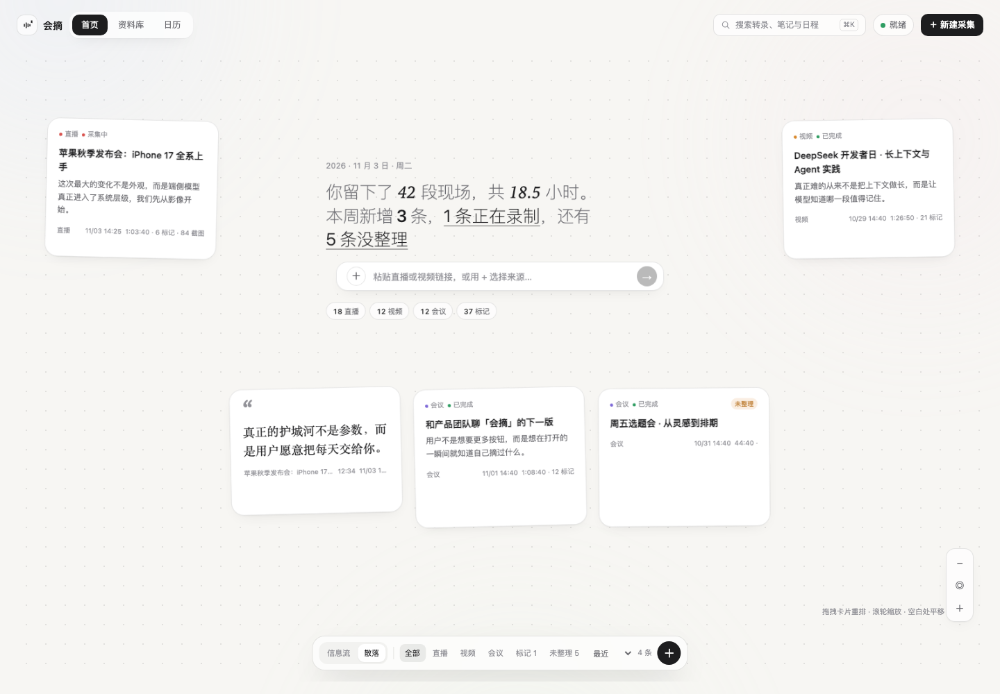
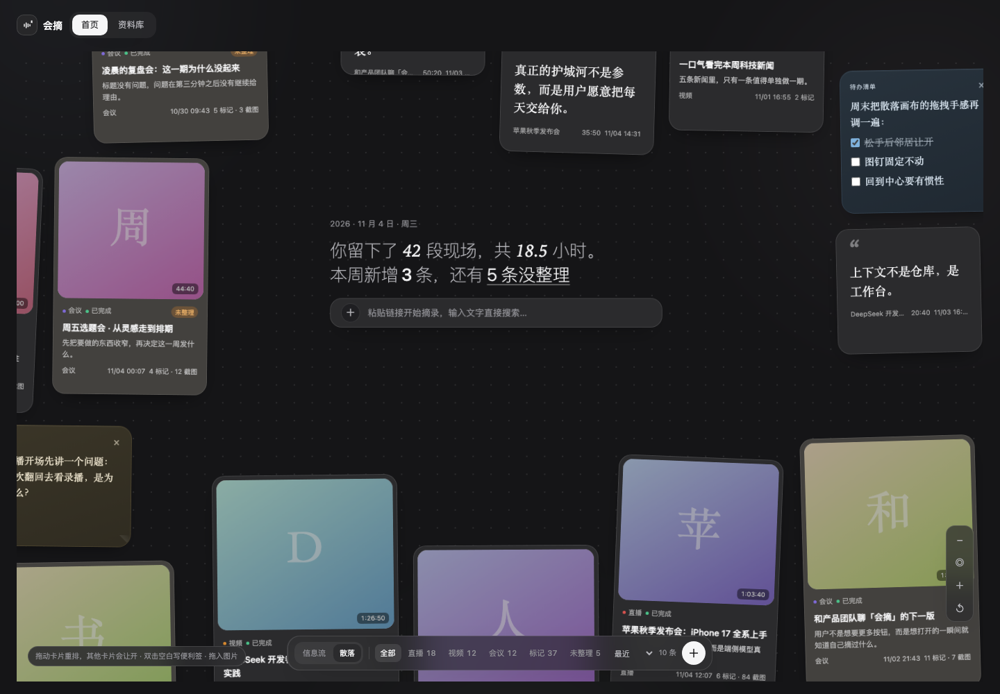
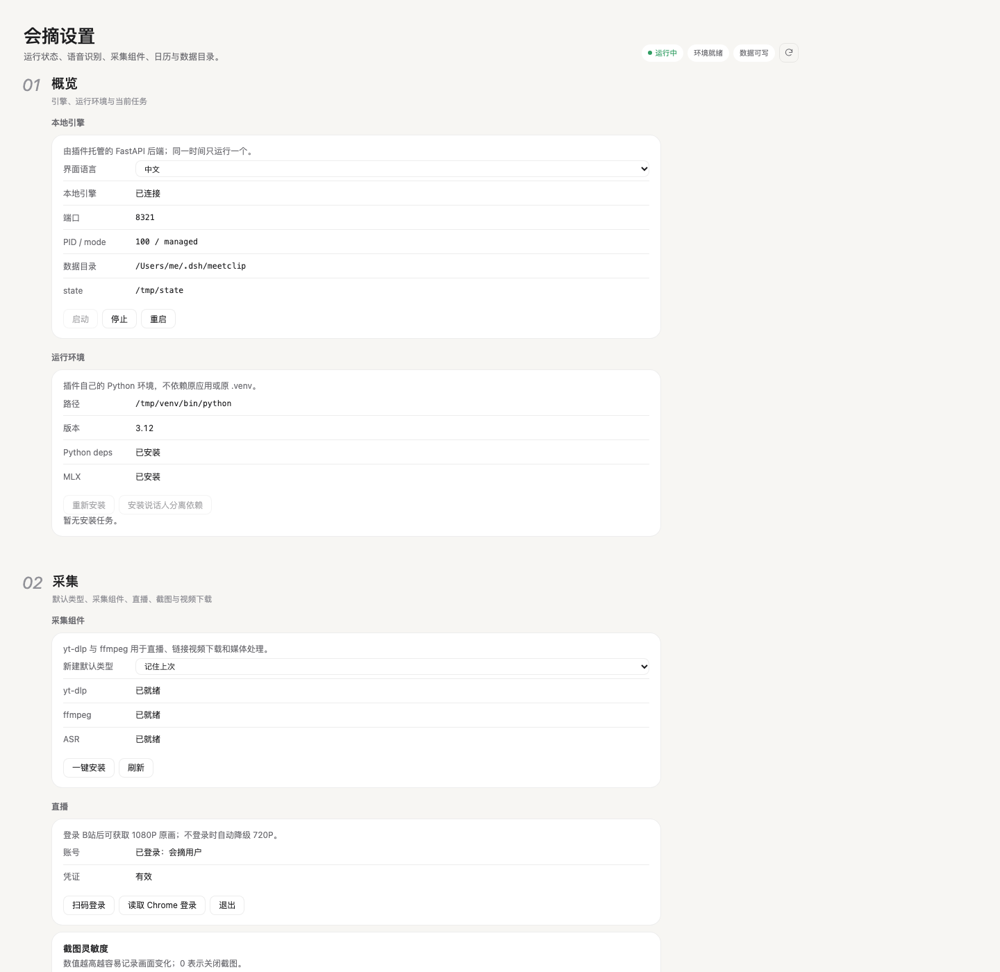

# 会摘 MeetClip · 变更记录

项目主页与安装说明见 [README.md](README.md)，历史细节按版本从新到旧排列。

- 插件包：`@meetclip/dsh-meetclip`
- 侧栏入口：**会摘**（主面板）
- 设置：**设置 → 会摘**
- 后端是原 macOS 会摘的 fork，基线与改动见 [backend/UPSTREAM.md](backend/UPSTREAM.md)

## 0.9.2 首页卡包、批量导入、更新回退与开源去敏

发布日期：2026-11-10。相对 0.9.1 的三块界面级新功能（首页卡包、会议批量导入、应用内回退），以及一次面向开源的彻底去敏。

### 开源去敏：不再内置任何组织内部服务

- **移除内置网关**：原先预置的内网 LLM 网关地址与它配套的模型名，从客户端、Host 探针、FastAPI 后端与文档里全部删除。默认服务地址与模型改为空，首次引导、设置 → 模型、首页配置卡都新增「服务地址（Base URL）」输入，占位符为 `https://your-gateway.example/v1`；没填时保存/测试给出「请先填写服务地址（Base URL）」，不再偷偷请求内置地址。
- **移除内网 npm 源与私有包名**：原先指向组织内部镜像的 npm 源与私有作用域包名一并删除。`feishuPackage` / `feishuRegistry` 成为 meetclip config 的配置项（也可用 `MEETCLIP_FEISHU_PACKAGE` / `MEETCLIP_FEISHU_REGISTRY`）；未配置时设置页显示「未配置 MCP 源」并说明该填在哪，安装按钮置灰，而不是报一个看不懂的网络错误。
- **模型名与品牌措辞**：供应商前缀不再写死（改为可选 `MEETCLIP_AI_MODEL_PREFIX`）；模型清单排序改为按当前配置的族名排序；界面文案里的「Mify / MiMo」统一改为「云端语音 / 默认网关（OpenAI 兼容）」，「检查公司网络／VPN」改为「检查网络或代理」。
- **行为不变的部分**：内置的 provider id 仍是 `mimo`（历史设置与记录里的引擎标识，不改数据库语义）；ASR 与纪要仍然共用一把 Key，仍支持自定义 API 与各自的模型。
- **升级提示**：已经配过网关的老用户设置在 `settings.json` 里，升级后照常可用；新装用户需要自己填一次地址、模型与 Key。

### 回归与验证

- 前端 `node --test tests/*.test.mjs` 242/242 通过；后端 `bash backend/tests/run-all.sh` 29 个测试文件全部 PASS（用 Python 3.12 的 venv）。
- 后端新增环境变量入口 `MEETCLIP_AI_BASE_URL` / `MEETCLIP_AI_MODEL` / `MEETCLIP_ASR_BASE_URL` / `MEETCLIP_ASR_MODEL`，便于 CI 与无界面部署；未配置时新记录仍可创建，只把「识别未就绪」如实显示出来。
- 全仓库扫描：内网网关域名、内网 npm 源、私有包作用域与厂商前缀在源码、文档、测试与重新构建的 `client.js` 里均为 0 命中（`backend/data/` 是本地运行数据，不进仓库也不进包）。

### 设置 → 关于支持回退到升级前的本地版本

- **为什么**：2026-11-10 应用内升级到 0.9.1 后出现过安装副本被发布包覆盖、界面回退的问题，当时只能手工从更新器备份里挑文件恢复；现在把这件事做成按钮。
- **一个按钮，只动本地副本**：「设置 → 关于」在「立即更新」旁新增「回退到 vX」，把安装目录换回**本机升级前由更新器保留的副本**（`.update-bak-<版本>-<时间戳>-<序号>`），不联网、不从 GitHub 下载旧版本，也不碰资料库、笔记、转写和 Python 环境。
- **看得见、可反悔**：新增「可回退版本」一行，列出本机备份的版本与备份时间，多个备份可下拉选择；只列完整备份，当前磁盘版本不重复显示。确认回退时会把当前版本也另存为备份，所以回退后还能「切换回 vX」。回退只交换目录，失败立即把原目录改回去。
- **状态与文案**：任务新增 `kind: "rollback"`，沿用 `installing` 状态并在进度卡显示「回退中 / 回退完成」；`status` 新增 `rollback`（可用备份、`canRollback`）与 `restartDirection`（`update` / `rollback`），重启提示会区分「新版本文件已就位」和「回退后的文件已就位」。没有备份（手工装包、源码运行或备份被删）时按钮置灰并说明原因；源码方式运行拒绝覆盖安装副本，与自动更新规则一致。
- **接口**：`POST /meetclip/app/update` 新增 `{ "action": "rollback", "version": "0.9.0" }`（`version` 可省，缺省用最近一份备份）。备份不完整或磁盘已是该版本时不会执行，返回 409/明确错误。
- **验证**：`tests/update-host.test.mjs` 新增 6 项（回退交换与再切回、指定旧备份、残缺/未知备份拒绝、交换后校验失败自动还原并保留备份、源码拒绝）、`update-routes.test.mjs` 新增 2 项、`update-client.test.mjs` 新增 2 项；前端 223/223 通过。用真实 profile 只读核对：0.9.1 安装副本列出 0.9.0（2026-11-1013:54:08）与 0.8.11 两份本地备份，`canRollback: true`。关于页浅色/深色截图见 `build/about-preview-shot.mjs rollback-confirm|rollback-done|rollback-none`。
- **限制**：本地备份只由应用内更新产生，且只保留最近 2 份；新版本界面完全打不开时用 `docs/UPDATE.md` 的手工 `mv` 命令做同样的事。

### 会议音视频批量导入自动成包

- **原生选择器支持多选与视频容器**：`src/host/files.js` 去掉了 `of type {"public.movie","public.audio"}` 的 UTI 过滤——macOS 会把 `.mkv`、`.flv` 等容器排除在外，导致「只能选录音」；现在选择器可多选，扩展名仍由 Host/后端白名单二次校验。多选结果用 ASCII 单元分隔符传递，文件名里的空格、中文、逗号不会被拆坏。
- **会议表单改成文件列表**：`MeetingForm` 支持原生多选与多文件拖拽，逐行显示视频/音频、大小、上传进度、失败原因，可单独移除；单次最多 20 个文件，不支持的扩展名与重复文件会跳过并提示。拖拽上传仍落到 `<stateDir>/uploads`，原生选择器直接用本地路径，不重复拷贝。
- **2 个及以上自动成包**：新增 `POST /api/meetings/import-batch`，逐条容错创建会议记录并入队；成功 2 条及以上时自动创建卡包（默认名 `会议录音 · MM-DD HH:MM`，可在表单里改），响应带 `ids`、逐条 `results` 与 hydrate 后的 `pack`。单文件仍走原 `/api/meetings/import`，不生成卡包。
- **转写中的成员也能在卡包里**：`packs.create_pack` 新增内部参数 `allow_active_sessions`，只供批量导入使用；手工 `/api/packs` 仍拒绝把进行中的记录收进卡包，原有语义与测试不变。首页卡包卡会显示进行中标记，筛选「全部/进行中/会议」都能看到。
- **导入后回到首页并打开卡包**：`Panel` 处理批量导入响应，toast 显示导入数量、卡包名、失败文件；`HomePage` 新增 `packFocus`，等首页数据刷新后自动打开新卡包浮层。单个文件仍按原行为打开记录详情。
- **失败处理**：逐条校验路径/扩展名/大小，单条失败不阻塞其他文件；整批总大小按磁盘剩余空间 −512MB 校验；入队失败只把该条标 error；卡包创建失败返回 `pack_error`，已入队记录不丢。
- **测试**：新增 `tests/meeting-files.test.mjs`（9 项）、`tests/host-picker.test.mjs`（5 项）与 `backend/tests/test_meeting_import.py`（9 项）；前端 237 / 237、后端全量通过，`interaction-smoke` 覆盖多选文件列表，`meeting-preview` 更新为双文件批量态。

### 首页卡包

- **散落画布新增「卡包」**：空白处右键可直接新建；把一张卡拖到另一张卡中央，停留约 160ms 上膛后松手，两张卡收进一个卡包并自动命名为「卡包 N」。上膛前松手仍按普通重排处理，Esc 可取消。
- **卡包是画布上的一张顶层卡**：成员从墙面收起，卡包占一格，继续参与现有避让求解；拖动卡包只移动容器，不破坏整面墙的间距。卡包固定 272×208，外壳直接叠放前 3 张真实成员卡（第一张在最前，叠放顺序与展开顺序一致），底部只留一条「卡包 ·标题 ·N 张」小标签，不再用灰色通用封面。
- **热区提示**：进入目标卡中央热区出现无边框的灰色呼吸光晕和「停一下，叠成卡包」；160ms 后光晕加强并变成「松手叠成卡包」，屏幕坐标提示不随画布缩放。原先的黑色虚线圈/实线圈已删除。拖到已有卡包上则显示「松手放进卡包 · N 张」。
- **打开与维护**：点击卡包打开浮层，成员直接用墙面原卡片按信息流多列平铺；按住任意卡片即可整卡拖动排序，指针在卡片上半时插到它前面、下半时插到它后面，顺序通过 `PATCH /api/packs/{id}/members` 回写，卡包外壳的叠放顺序同步更新。可打开成员、移出成员、改名、解散；解散只把成员放回墙面，不删记录。新建空包/合并/加入后提供 5 秒撤销；图钉卡和进行中的记录不能作为收纳对象，进行中的记录也不能拖进卡包（服务端同样拒绝）。
- **数据**：新增 `card_packs` / `card_pack_members` 两张表与 `/api/packs` 读写接口（含成员排序），`/api/home` 返回 hydrate 后的卡包；成员被删除时读取自动跳过，不抛 500。一张卡最多属于一个卡包，一个卡包最多 60 张卡；卡包位置沿用现有本机手动位置存储，内容随资料库持久化。
- **视图语义**：散落与信息流都折叠卡包；类型筛选下只要包内任一成员匹配就显示整包，空卡包始终显示。筛选不会重排墙面。
- **所有首页卡片都能 @**：卡包、便利签、标记、图片、批次也会物化成 `会摘卡片/` 下的 Markdown（卡包在 `卡包/<标题>.md`，其他在对应子目录），`GET /api/cards` 与 Agent @ 菜单统一列出；卡包卡片包含成员类型、标题、session_id/文档链接，Agent 可再按成员 id 读取详情。
- **右键基于卡片/卡包提问**：记录、卡包、批次、便利签、标记、图片、飞书文档的右键菜单新增「基于此卡片/卡包提问」。动作先同步卡片文件，再按精确 id 取卡，新开 Agent 会话；结构化 @ 引用只放进输入框，不自动发送。缺少 `conversation` 输入模型时退回工作区纯文本草稿。
- **发送后 @ 显示修复**：用户消息发送后会按 `@路径` 重新匹配文件引用，显示文件名。卡包/便利签/标记/图片/批次卡片改为按标题命名（同名追加序号），不再出现 `81a26c275e57.md` 这类哈希文件名；卡包改名后文件随标题重命名，旧文件由同步清理。历史消息里的旧路径无法回写，新 @ 会显示可读标题。
- **浮层整卡拖动**：去掉右上角“⠿”把手，按住任意卡片的非交互区域即可拖动整张卡；原位置淡出，整卡浮层跟随指针。指针在目标卡上半时，卡片上方空隙出现横向插入线和「插入到这里」；在下半时出现在下方空隙，松手插到两张卡之间，不再用选中圈。排序失败会回滚；空点/拖动距离不足 7px 仍按点击打开卡片。
- **验证**：后端全量 29 个测试文件通过，新增 `test_packs.py` 覆盖创建/幂等/唯一归属/进行中拒绝/改名/加移成员/排序/删除/成员失效/鉴权；前端 `node --test tests/*.test.mjs` 241 项通过，`render-smoke` 与扩展后的 `interaction-smoke`（空白右键建包、上膛热区、拖卡叠包、全卡片浮层、整卡拖动、右键提问与结构化 @ 草稿、筛选、改名、撤销、解散）通过；`build/build-scatter-preview.mjs` + 无头 Chrome 核对浅色/深色卡包与热区截图。安装副本同步后刷新 DSH 页面生效。
- **更新回退与恢复**：2026-11-10 13:54 应用内更新到 0.9.1 时，安装副本的 `client.js` 与卡包后端文件被发布包覆盖，界面回退；但 `card_packs` 数据仍在 SQLite 里。核对 0.9.1 运行时文件与 0.9.0 基线一致后，从更新器备份 `dsh-meetclip.update-bak-0.9.0-20261110-135408-48172` 恢复卡包相关文件，保留 0.9.1 发布元数据；恢复后用户更新前创建的 `pack-mwa9vmrl-ab3gz6`（卡包 1，3 名成员）直接回到 `/api/home`。以后每次应用内更新仍会覆盖安装副本，正式发版前需要重新打包该功能。
- **二轮 UI 与性能**：卡包浮层改用原卡片三列信息流并支持把手排序；外壳改真实成员卡叠放；热区去掉黑线只留灰色呼吸光晕；散落画布拖拽从「每个 pointermove setState 重绘整墙」改为直接写被拖卡片的 `transform`，并缓存舞台矩形，避免逐帧同步布局。

### 纪要要点锚点回填

- 0.9.1 用真实记录复验时发现：分窗整理时模型偶尔只把 evidence 写在主题上、要点里不写，这些要点点不动，还会被标成「依据较少」——79 分钟的记录 82 条要点只有 40 条带时间。
- 新增 `backfill_point_times`：按文字相似度（≥0.3）在本窗转写里给缺锚点的要点补一个时间，且只在主题自己的时间范围内找，宁可留空也不跨章乱挂；`_run` 每窗合并后都会跑一次。
- 用真实记录 `70fd40a9ce77` 复验并回填：22 个章节覆盖 `1:40–1:18:03`，82 条要点里 77 条带可跳时间，笔记与卡片同步刷新。
- `test_minutes.py` 34 项、后端 27 个测试文件、前端 199 项通过。

## 0.9.1 第三方许可与发布合规

- 新增 [THIRD_PARTY.md](THIRD_PARTY.md) 和 [LICENSES/Apache-2.0.txt](LICENSES/Apache-2.0.txt)：明确 AI 纪要模板、文本清洗、会议结束信号等部分派生自知了 Cicada（Apache-2.0），保留原项目署名与许可证全文。
- 插件包与 GitHub Release 一并携带 `THIRD_PARTY.md` 与 `LICENSES/`，满足 Apache-2.0 对分发副本的声明要求。
- 无运行时行为变化；0.9.0 用户点「设置 → 会摘 → 关于 → 检查更新」即可升级到本版本。

## 0.9.0 开源首发 + 应用内自动更新

- **以 MIT 协议开源** 到 <https://github.com/dengluliang/dsh-meetclip>，包含 Host、Client、FastAPI 后端、内置 skill、测试与构建脚本。
- **设置 → 关于**：显示当前运行版本、磁盘已安装版本、最新版本、发布仓库、上次检查时间和安装位置。
- **检查更新**：读取 GitHub Releases 的 `latest.json`（优先，无 API 限流），失败时回退 GitHub API；按 semver 比较，不降级、不重复安装已下载版本。
- **自动下载并安装**：一次点击完成检查 → 流式下载（百分比、已下载/总量、速度）→ SHA-256 校验 → 安全解包 → 原子替换 DSH profile 里已安装的插件副本；完成后提示重启 DeepSeek Harness。
- **进度与取消**：Host 侧 job 状态机（检查/下载/校验/安装/完成/失败/取消），Client 每秒轮询；下载阶段可取消，安装阶段不可中断。
- **回滚与恢复**：替换前保留 `dsh-meetclip.update-bak-*` 备份（最近 2 份）；替换或校验失败立即还原；上次进程中断后下次启动自动从备份恢复。
- **安全边界**：只允许 GitHub/HTTPS 下载源；强制 SHA-256；解包拒绝绝对路径、`..`、符号链接、设备文件，限制压缩包/解压体积与条目数；不执行 shell；不修改资料库；不上传本地数据。
- **源码保护**：检测到插件从源码目录运行时，自动安装会被替换为「请 git pull」的提示，不覆盖源码。
- **发布链路**：新增 `build/release.mjs`、`latest.json`、`SHA256SUMS.txt`，Release 资产可由维护者一键生成并上传。
- **开源整理**：新增 README、LICENSE、CHANGELOG、`docs/UPDATE.md`；清理真实飞书文档链接、个人绝对路径和内部服务措辞；飞书外链改为按 `feishu.cn` / `larksuite.com` 后缀放行，支持任意租户。
- **测试**：新增 Host/路由/Client 共 28 项更新测试，前端全量 199 项通过；包含下载进度、取消、哈希失败、路径穿越、回滚、中断恢复和「已安装待重启」用例。

> 上一节 0.8.12 的纪要时间轴修复包含在 0.9.0 中。

## 0.8.12 变更（纪要时间轴按转写锚定）

- **现象**：一条 1:19:20 的视频，纪要时间轴第一个章节显示 `1:49:47`，比整条视频还长，点进去会跳到片尾之外；同一条记录的章节实际只覆盖最后 9 分钟。
- **根因一：模型自己算的秒数被直接采信**。提示词里的转写行是 `[L601 01:09:47 发言人] …`，模型要先把钟点换算成秒再填 `topics[].start`；它把 `1:09:47` 算成了 6587 秒（1:49:47），`minutes_prompt.parse` 原样存库，页面、笔记、导出、卡片和 `meetclip_minutes` 都照这个数渲染。
- **根因二：长记录终稿分窗只看最后一窗**。超过 300 行的终稿按 300 行切窗，但只有第一窗的提示词带「当前纪要」，最后一窗的回复又直接替换 `base`，前面几窗的章节全被丢掉——678 行的发布会于是只剩最后 9 分钟。
- **修复**：
  - `parse` 不再采信算错的 `start`：起点必须落在媒体长度内，且不能晚于自己的第一条证据（`topic_start`）；比第一条证据早 3 分钟以上也按证据重算。提示词补一条「start 用转写时间换算，拿不准就留空，不要自己加减」。
  - 终稿分窗改成「每窗带着上一窗的纪要接着整理」：`build(carry=True)` 把当前纪要发回模型，但 `merge_window` **以旧主题为准**——保留上一窗里带证据的版本，只追加本窗新整理的主题（模型借「整份发回」重写老主题时，重写后的要点没有证据行号，时间锚点会整片丢失）；分窗中任一窗没返回就不落残缺终稿，保留上一版。
  - 读兜底 `sanitize_topics`：旧库里已经写坏的起点在 `engine.get()` 时按证据重算，页面、笔记、导出、卡片与 `meetclip_minutes` 拿到的都是能跳的时间；直播增量落库前也会先修上一版。
  - 跨窗接时间：当前纪要里的要点带 6 位短 id（文本 sha1），模型改写要点时只要带回 id，或用文本相似度 / 主题起点对得上，`carry_times` 就把原来的时间与依据数接回去；同名主题的起点只前移不后移。输出被 `max_tokens` 截断时自动把预算 4096 → 8192 重试，不再把整条终稿判失败。
- **验证**：真实记录 `70fd40a9ce77`（1:19:20）的 6 个章节起点由 `6587 / 6727 / 6787 / 6856 / 6946 / 7079` 修正为 `4187 / 4327.9 / 4389.3 / 4491.9 / 4572.4 / 4683.2`（1:09:47–1:18:03，与要点时间一致）；`test_minutes.py` 27 项、后端全量套件（27 个测试文件）与前端 171 项全部通过。
- **限制**：已经生成的旧纪要只修时间、不补内容——要补回被丢掉的章节需要重新整理一次（消耗一次 AI 配额）。

## 0.8.11 变更（飞书文档卡片）

- **首页「＋」菜单新增第四入口「飞书文档」**：和「发布会直播 / 视频链接 / 会议录音」同级；粘贴 `https://example.feishu.cn/docx/...`（以及 `/wiki/`、`/sheets/`、`/base/`）链接后，**650ms 防抖自动预读文档标题、正文长度与一小段摘要**，标题填入输入框、可改，确认后再生成一张可在会话里 `@` 的会摘卡片。底部「新建采集」弹层也有同一个「文档」页签。
- **正文读取不新增飞书授权**：Host 直接调用已配置的飞书 MCP `mcp__feishu__doc_read`（wiki 先 `mcp__feishu__wiki_get_node` 解析 `obj_token`）；MCP 未载入/被策略拒绝/超时时，docx 再用本地 `~/.feishu-mcp-pro/auth.json` 里未过期的用户 token 走一次只读 Open API；仍失败则落「仅链接」卡片并在界面说明原因，不抛裸 500。
- **卡片形态**：`<数据目录>/会摘卡片/<标题>.md`，含标题、链接、文档 ID、类型、修订和正文快照（最多 12,000 字）；`doc_cards` 表记录 `doc_type:token` 去重、文件名、签名与搜索文本。`GET /api/cards` 把文档卡和记录卡混排在同一个「会摘卡片」分组，描述显示「飞书文档」或「仅链接」；首页摘录墙/散落也会把文档卡作为独立卡片列出（筛选条新增「文档」），点击直接打开飞书原文；文档卡没有 `session_id`，`meetclip_records` 不认它。
- **幂等与文件名**：再次添加同一文档只刷新内容/时间，不产生第二张；标题变化会重命名文件；记录卡与文档卡互相避开文件名（casefold），`sync_cards` 不删除文档卡，改名删除旧文件时也不会误删同名记录卡。
- **接口**：新增 `POST /api/cards/doc`（后端落文件 + DB）、`POST /meetclip/app/feishu/doc-card`（Host 读文档并登记）与 `POST /meetclip/app/feishu/doc-preview`（只预读标题/长度/摘要，不落卡）；系统提示明确区分「记录摘要卡」与「飞书文档卡」，后者需要最新全文时用 `mcp__feishu__doc_read` / `doc_fetch`。
- **限制**：`sheets` / `base` / 旧版 `docs` 本期只登记链接（不拉表格/多维表格正文）；不做 AI 摘要、不自动同步飞书最近文档；`/jianbao` 生成飞书文档后不自动登记卡片，需要时用「＋ → 飞书文档」手动添加。
- **验证**：真实文档 `https://example.feishu.cn/docx/ExampleDocToken1` 经 `POST /meetclip/app/feishu/doc-card` 返回 `has_content=true`，生成 `会摘卡片/会议纪要：示例.md`，`GET /api/cards?q=示例` 与 `/meetclip/api/cards` 均命中；Open API 兜底单独验证读到 2,270 字；`node --test tests/*.test.mjs` 171/171、render/interaction smoke 通过；后端临时目录用例覆盖生成/幂等/改名/同名冲突/路由。

## 0.8.10 变更（播放条重做）

- **根因：桌面端媒体不可 seek**。DSH 桌面窗口跑在 `dsh-app://` 自定义协议下，Electron 主进程转发流式响应时会删掉 `Content-Length`；在真实 App 里实测 `video.seekable` 是 `[[0,0]]`，`currentTime` 赋值被忽略——所以点时间轴、点转写时间戳都不会动，看起来像“从头重放”。现在桌面端点播媒体会在请求上带 `direct=1`，后端返回 307 到本地 `http://127.0.0.1:8321/...` 直连地址；实测同一个 AV1 回放变成 `seekable [[0,281.45]]`，设 140s / 53s 都精确生效。Web 端（http 页面）不改变原路径。
- 播放条改成两层：上一行是占满整宽的时间轴，下一行是播放、时间、倍速、音量、全屏。时间轴悬停/拖动时在指针上方显示精确时间。
- **时间轴点击/拖动改由透明原生 `input[type=range]` 处理**：由浏览器计算点击位置，不再依赖 `pointerdown/pointerup` 的 `clientX`；自绘轨道、气泡、截图/打点/搜索命中刻度都保留。
- 倍速收成 `1x` 小菜单；音量用喇叭图标 + 短细滑杆，避免和时间轴混淆。
- **转写行不再被残留选区挡住**：以前页面上只要还有文字选区，点任何时间戳都会直接 return。现在只有本次按下后拖动超过 4px 才当作选字复制；普通单击会清掉旧选区并跳转。
- 内容页改为播放器固定在列顶部、只有转写列表自己滚动；跟读只调整列表 `scrollTop`，播放器不会再被自动跟读顶出视野。
- 画面上限按窗口高度收（`min(44vh, 420px)`），矮窗口里转写仍保留可读区域。
- 验证：真实 DSH 桌面窗口（Electron）里隐藏媒体 `seekable [[0,281.45]]`、140s/53s 跳转成功；同一条 AV1 回放在真实 GUI 点时间轴 19%/50% 落到 53.38s/141.2s，残留选区下点转写 00:00 落到 1.06s，列 `scrollTop` 全程 0。单测 159/159、交互与渲染冒烟通过。


## 未发布：空白片段不再吐出 `<chinese>`

- 转写遇到没有人声的片段（静音、掌声、音乐），云端识别模型会把语言标记当正文：先是一个 `<chinese>`，片段长一点就一路重复到输出上限——界面上滚出一大片标记，这一段还会以「输出被截断」失败，把整条记录卡在「部分完成」。
- `text_hygiene.clean` 现在统一剥掉 `<chinese>`、`<|zh|>`、`<|NEUTRAL|>`、`[Music]` 这类控制标记；剥完只剩标点的片段按空处理：不写转写、不占时间轴，也不算「有语音」。
- 流式输出累计 400 字仍没有正文时立即掐断请求、按空片段返回，不再把整段请求跑满；流式预览走同一套清洗，界面上不会再出现那面标记墙。
- 已完成的片段不受影响。中途失败的链接记录点「重试」会从断点续传，只补没做完的片段。

## 0.8.9 变更（首页 Agent 入口）

- **首页 `＋` 改成三入口菜单**：发布会直播 / 视频链接 / 会议录音。点击 `＋` 只弹菜单，选择后才进入对应采集流程；会议录音仍走本地文件选择器，直播与视频链接打开原有的行内采集表单。
- **首页输入框改成 Agent 对话框**：输入内容按回车后，在「会摘默认工作区」新建一个 DSH 会话，把原文发给 Agent，并自动切换到该会话。发送失败时留在会摘面板、保留已输入文字并显示原因。
- **链接与搜索不再由 Hero 智能识别**：粘贴链接回车会把链接原文发给 Agent（Agent 可调用 `meetclip_capture`），需要结构化采集时用 `＋` 菜单。全局搜索回到顶栏「搜索」按钮，`⌘K` 保留。
- 采集与 Agent 输入互不清空：打开采集面板不会丢掉已输入的 Agent 文字，取消采集后还能继续编辑。
- Hero 发送的是纯文本；DSH 的 `/` 命令与 `@` 引用芯片仍需在会话输入框里输入。

## 0.8.8 变更

- 修复纪要高亮"点了有记录但结构化视图不显示"：后端把高亮片段用 NFKC 归一化，中文全角标点（`，：＋`）被折成半角，和界面里的原文再也对不上。现在高亮原文按原样保存；客户端定位再加一层规范化兜底，已经存坏的老高亮无需重新高亮也能显示。
- 去掉面向用户的「已勾选 N 项 · 高亮 M 处 · 会摘助手可见」「已高亮，会摘助手可见」提示。勾选和高亮仍然写回后端、同步进笔记 / 导出 / 卡片 / `meetclip_minutes`，只是不在纪要工具条里显示给用户。

## 0.8.7 变更（内置「发布会简报」skill）

插件随包内置一个 skill，装好插件即可在会话里用 `/jianbao` 调用，不需要另外配置 skill 目录。

**用法**：`/jianbao` + `@` 一条会摘卡片，例如：

```
/jianbao @[全程回放]-今日宜休 AI睡眠科技生态发布会.md
```

也用自然语言触发：「把这条发布会整理成飞书简报」。skill 会读卡片拿到 `session_id`，分页读全量转写，定小节与时间区间，按小节抽现场帧，然后建飞书文档并返回链接。

**产出结构**：`概述`（高亮块，3–5 组「标签 + 定性 + 分条」）→ 源视频播放器 → `回看索引`（小节 + 时间区间 + `?t=秒` 跳转）→ `产品概要` / `价格` / `参数表` / `发布会详情`（官方卖点小节 + 2–3 张并排截图 + `卖点名 @MM:SS` 图注）。默认 40–80 张图。

**内置资源**：`skills/jianbao/`

| 路径 | 作用 |
|---|---|
| `SKILL.md` | 七条硬规则与六步流程（含「存疑先问、澄清后才写」） |
| `references/风格蒸馏.md` | 33 篇人类稿统计出的体例事实与禁写清单 |
| `references/文档模板.md` | 可直接套用的骨架与 `plan.json` 格式 |
| `scripts/frames.py` | 配图：优先用 `<dataDir>/<session>/shots/` 现成截图，无则对 `media.mp4` 做 scene 抽帧并去重 |
| `scripts/build_doc.py` | 装配：填充时间戳索引、按图片数量自动分批 |

加载时 Provider 会把 `references/`、`scripts/` 的绝对路径与可用 python 注入到说明末尾（`src/host/skills.js`）。

**命名约束**：DSH 的 skill / 命令名只接受 ASCII kebab-case（`^[a-z0-9]+(?:-[a-z0-9]+)*$`），中文名会被注册器拒绝，因此命令词取拼音 `jianbao`；中文「发布会简报」写在 skill 的 description 里，`/` 菜单会作为说明显示。

## 未发布：批次连续添加与续排

- **批量入队不再“一次用完”**：视频表单提交第二批链接后保持打开，输入框只保留没成功的行，下面直接给出「已加入 N 条 · 继续粘贴链接可再加入一批」。点「完成」才关闭并定位到最近一批；单条链接仍沿用原来的「提交即打开记录」。
- **全部重复/失败不再只剩 HTTP 400**：后端 400 里带的逐条结果现在会渲染成结果列表，并出现「仍然加入重复链接」——确认后按 `allow_duplicate=true` 重新提交这些行，不用整段重贴。
- **已有批次卡可以直接续加**：批次浮层新增「批量加入新链接」，批次卡右键菜单也新增「加入新链接」；提交时带上 `batch_id`，新链接续排到原批次（`meta.batch.index` 接着往后排，`total` 与 `updated_at` 更新），不会另开一张批次卡。
- **批次按最近追加排序**：首页 `batches` 的 `updated_at` 取成员里最新的追加时间，刚续加过的批次卡回到最前，浮层显示「更新 …」；未追加过的批次仍按创建时间排。
- **接口**：`POST /api/link-videos/batch` 新增可选 `batch_id`；未知/已删除批次返回 404「批次不存在或已删除」，单条链接也能续排到已有批次（`batch_id` 存在时即使只提交 1 条也归入该批次）。
- **验证**：`backend/tests/test_link_video.py` 新增续排序号/总数/单条续排/未知批次 404 用例（50 项），`backend/tests/test_home.py` 新增追加后排序用例（15 项）；`build/interaction-smoke.mjs` 新增「批量表单不关闭、连续提交两批、全部重复后仍然加入、批次浮层带 `batch_id` 续加并刷新成员」断言；`node --test tests/*.test.mjs` 147/147、`render-smoke`、`interaction-smoke` 通过。
- **未验证**：真实平台（B站/抖音等）续加的下载链路只验证了入队、批次聚合与 UI；真机建议先在一个已完成批次里追加 1–2 条确认。

## 0.8.6 变更（多资料空间）

- **一份目录 = 一份资料空间**。记录、转写、笔记、AI 纪要、截图、会摘卡片与日历链接都跟着目录走，工作与生活各自独立；同一时刻只有一个「激活空间」在跑，切换 = 停引擎 → 换目录 → 重启（几秒）。
- **入口放在首页顶部右侧**：`( 首页 | 资料库 )` 右边多了一个胶囊 `● 工作 ⌄`，点开列出全部空间（条数、位置不可用会标出来）、`＋ 新建资料空间…`、`⚙ 管理资料空间…`。放在这里是因为切换是**跨视图的全局状态**：放首页会在资料库里消失，Hero 又已被日期、采集框与统计占满。首页日期行尾部只用三级色标一下当前空间名，采集确认里显示「将保存到：工作」，避免把工作会议录进生活库。
- **一次切换，整站生效**：首页信息流/散落、资料库列表、⌘K 全局搜索、`meetclip_*` 工具、`@` 会摘卡片全部指向新空间；切换期间界面不会误判成「未配置」，失败自动回滚到原空间（`prefs.json` 与 `dataDir` 一起还原）。
- **采集不会白断**：切换前先问一次。返回的任务清单会列出正在录制/转写/排队的记录，确认后先对采集中记录调 `POST /api/sessions/{id}/stop` 让它自己收尾（保存已录到的媒体），再停引擎——不会留下「上次应用异常退出」的脏状态。
- **账号与通用设置只有一份**：云端 API Key 与日历密码本来就在 macOS 钥匙串（`cn.meetclip.asr` / `cn.meetclip.calendar`，全局共用）；B 站/抖音登录态与语音、画质、截图灵敏度这类设置放进共享目录（默认 `~/.dsh/meetclip/shared`），切换空间不用重新登录。启用时**只复制、不删除**原文件；`MEETCLIP_SHARED_DIR` 不设置时后端行为与单库版本完全一致（外部引擎也不受影响）。
- **@ 卡片跟着当前空间**：`@` 菜单只列激活空间的卡片；当会话工作区其实属于另一个空间时，面板给一行可点击提示「当前工作区属于『生活』…→ 切换到『生活』」，而不是列一堆对不上的卡片。
- **`meetclip_status` 会说明当前空间**（`library` / `libraries` / `sharedDir`）；记录 id 不存在时返回可执行的提示（「可能在另一个资料空间，先看激活的是哪个」），系统提示也明确要求不要在跨空间上臆测。
- **设置 → 资料空间**（新标签）：一行一个空间（名称、`正在使用` / `位置不可用` 徽标、路径、条数），右侧动作分级——`切换` 只出现在非激活行（实心），`改名 / 加入工作区` 为次级文字按钮，`移除` 悬停才变红且激活行禁用；上面一条工具栏是计数 + 刷新 + 新建。空态、宿主未加载态各有说明与唯一主按钮，不再把 `HTTP 404` 直接摊给用户。「移除」只从列表拿掉、**文件一个不删**，且不允许移除正在用的空间或最后一个空间。原来的「存储位置」卡仍在 设置 → 采集，负责目录与搬家；两者分工是「现在用哪一份」与「这一份放在哪」。
- **设置页统一间距**：新增 `client-src/settings-spacing.css`——设置里的卡片改成 flex 列，块间距只由一套数值决定（小节之间 22px、小节标题↔卡片 10px、卡片内块间隔 14px、按钮横排 8px），并把卡片内子块自带的 margin 归零，解决「按钮 → 说明文字」有时 0px、有时 14px 忽紧忽松的问题；说明文字统一 12px/1.65、次级色。作用域限定 `.mc-settings-shell` / `.mc-settings-panel` / `.mc-lib-card`，不动首页、资料库与弹窗。
- **兼容**：`POST /meetclip/app/data-dir`、`/app/prefs` 与首次引导行为不变（内部变成「建/收养一个空间并切过去」），错误码与回包字段保持原样；`prefs.json` 写入时保留旧的 `dataDir` 镜像并先备份 `prefs.json.bak-v1`，降级回旧宿主不会炸。
- **目录身份**：每个空间目录里写 `.meetclip-library.json`（`{id,name,createdAt}`），目录被改名或拷到别的机器后重新收养仍是同一个空间；`id = sha1(realpath)[:10]`。
- **验证**：`node build/libraries-e2e.mjs`（真引擎、临时目录、22 项断言：切换后健康检查的 `data_dir`、库间记录隔离、共享目录就绪、`prefs.json` 镜像与备份）；`tests/libraries.test.mjs`（迁移/建库/收养/改名/移除/切换/回滚/共享目录/兼容路由，19 项断言组）、`tests/libraries-client.test.mjs`（名称校验、菜单排序、目录匹配、任务归纳）、`backend/tests/test_shared_paths.py`（共享目录落点与回落）、`build/interaction-smoke.mjs` 增加切换器与资料空间标签的断言；`build/libraries-preview.{html,png}` 是深浅色两套视觉预览。

## 0.8.5 变更

- **时间戳真的会跳了**：内容页和纪要页现在共用同一个播放器，切换标签不再卸载媒体元素，所以在纪要里点时间锚点也能直接跳回视频/录音对应位置。纪要页里播放器收成一条迷你播放条（播放/暂停、时间、进度、音量、回到内容页），边读纪要边听。
- 统一了跳转逻辑：媒体元数据还没就绪时先记住目标，加载完自动补跳；HLS 直播 `duration` 为 Infinity 也能跳；目标落在当前可回放窗口之外（直播只保留最近一段）或超出媒体长度时，钳到能播的位置并提示，不再静默失败；记录没有媒体文件时明确提示原因。
- 纪要互动：待办点一下即划掉并写回；选中文字后右键「高亮所选」（工具条也提供按钮），高亮保存为原文片段 + 前后上下文，纪要重写后片段还在就继续显示；右键或点高亮可取消。
- 互动会留痕：新增 `session_minutes_interactions` 表与 `GET/PUT/DELETE /api/sessions/{sid}/minutes/interactions`。勾选和高亮同步写进笔记里的纪要段落（`- [x]`、`我高亮的内容`），并出现在复制、导出、会摘卡片和 `meetclip_minutes` 的 `todos[].done` / `user_interactions` 里，Agent 能知道这项已完成、这段被高亮过。重新整理纪要不会丢互动；删除纪要会一并清空。
- 新增真浏览器验证 `build/seek-e2e.mjs`：真后端 + 真媒体 + Chrome，覆盖会议录音、链接视频、HLS 直播的转写跳转，纪要锚点跳转，以及假直播会话上的待办勾选/右键高亮持久化。
- **直播开始采集后自动播放**（不用再点一次播放）：播放器就绪即调用 `play()`；浏览器若拦下有声音的自动播放，先静音出画面并显示「已静音播放 · 点击开启声音」，用户第一次在面板里点击时自动打开声音。画面本身可点按播放/暂停，暂停时有居中的播放标记；分片中断时显示转圈重连，连不上才给出错误与「重试」，不再一错就退回静态预览图。
- 修复直播黑屏/点不开的根因：`canPlayType('application/vnd.apple.mpegurl')` 在 Chromium 上也返回 `"maybe"`，旧代码据此以为浏览器能原生播放 HLS，跳过了 hls.js；实际 Chromium 放不了 MPEG-TS 分片，于是画面全黑、点播放没反应、时间戳也跳不动。现在只要有 `MediaSource` 一律走 hls.js，只有没有 MSE 的 Safari/iOS 才用原生 HLS；hls.js 对网络/媒体错误按次数重连，并在 12 次失败后才提示。
- 直播播放条可拖动：`duration` 为 Infinity 时用 `seekable` 分片窗口做进度条（不再永久禁用）；首个分片生成前显示「正在连接直播流…」（有预览图时垫在背后），回放文件生成中显示对应提示。
- 时间戳补跳更可靠：播放器还没挂上 / 元数据未就绪时先记住目标，播放器一出现（首个 HLS 分片或回放文件）就自动补跳；还没有任何媒体时也区分「采集中」与「确实没有媒体」，不再误报。
- **录制的停止按钮改成红色**：详情页采集中/内录中的「停止」用主题错误色填充（`data-variant="stop"`），高度、圆角、字号与旁边的小按钮完全一致；停止确认弹层的确认键同样变红。悬停时按主题明暗自动加深/提亮，禁用态回落到普通灰色，不新增硬编码颜色。
- 新增真浏览器验证 `build/live-player-e2e.mjs`（真 Chrome + 真 HLS event playlist，10 段断言）：无手势静音自动播放、有手势有声自动播放、就绪前点时间戳的补跳、点 00:06 后 `currentTime≈6.00` 且播放条同步显示 00:06、全屏铺满。

## 0.8.4 变更

- 修复首次引导第二步被误判为「存储位置不可写 / 没给 DeepSeek Harness 完全磁盘访问权限」：旧逻辑检查的是首次安装时尚未创建的默认目录 `~/.dsh/meetclip/data`，`fs.accessSync` 返回 `ENOENT` 被当成权限失败。现在检查用户真正选择的目录，不存在的目录按最近的可写祖先判断。
- 授予完全磁盘访问权限后 macOS 会缓存旧决定；错误提示现在明确要求**完全退出（⌘Q）并重新打开 DeepSeek Harness**，同时提示可以点「选择…」换到「文稿」以外的目录。主界面的「数据目录不可写」横幅同步更新。
- 存储位置预检改为轻量检查（`measure:false`），不遍历已有的大资料库；缺失目录不预检拦截，交给保存步骤真正 `mkdir`（TCC 授权提示在真实写入时才可靠）。保存失败时附带「重启/换目录」提示。
- 修复相邻边界：目标路径的最近已存在祖先是文件时，不再误判为可写。
- Host 新增缺失目录可写判断、数据目录检查路由的测试。

## 0.8.3 变更

- **会摘工作区支持 @ 卡片**：在「会摘资料」工作区新建会话，输入 `@` 时菜单顶部出现「会摘卡片」分组，按最近时间列出记录标题；输入标题、摘要或笔记里的关键词都能过滤。选中后插入一个文件引用，连续 `@` 可以同时带多条记录进上下文。
- **每条记录生成一张 Markdown 卡片**：`<数据目录>/会摘卡片/<标题>.md`，含元信息、AI 纪要、我的笔记、标记、最多 12 段/2,000 字转写预览，以及 `session_id` 和 `meetclip_*` 工具提示。完整转写仍由工具按页读取，卡片是有界摘要，不会把整场会议塞进上下文。
- **自动同步**：改名、删除、笔记/纪要更新后，Host 在引擎启动、添加 DSH 工作区时触发同步，另有 60 秒增量定时器；`@` 菜单打开时也会做一次 2 秒节流的检查。内容签名不变就不重写文件，避免 DSH 文件树和 @ 索引抖动。
- **同名与安全文件名**：同名标题自动追加 ` (2)`；文件名替换 `/ \ : * ? " < > |` 与控制字符，限制长度，Windows 保留名加前缀。卡片是派生数据，可随时重建，请勿手工编辑。
- **降级路径**：DSH 没有 `inputTriggers` 时，卡片文件仍会出现在标准 `@` 文件菜单；后端是旧版/外部后端、没有 `/api/cards` 时只记一次日志并停用卡片同步，不影响采集、转写和 `meetclip_*` 工具。
- 新增 `GET /api/cards` 与 `POST /api/cards/sync`；客户端新增 `meetclip-cards` 的 `@` source（order -10，仅当当前会话 cwd 就是会摘工作区根目录时出现）。不新增运行时 npm 依赖，不调用 AI。
- **0.8.11 起同一分组也列飞书文档卡**：`doc_cards` 与记录卡混排，卡片文件同样落在 `会摘卡片/`，详见上面的「0.8.11 变更（飞书文档卡片）」。

## 0.8.2 变更

- 时间轴改成「按比例的分段条 + 可换行的主题索引」：8 个主题时按 3 列排，时间与标题完整显示，不再被等宽分段截断；点击仍跳到主题开始。
- 「纪要」页去掉外层卡片的 18px 圆角和阴影，正文纸张也去掉边框/圆角/底色，改成整页文档；复制按钮、时间轴分段条等小控件保留圆角。

## 0.8.1 变更

- 「纪要」页新增结构化视图（默认）：按会议/视频/直播模板分节，结论编号、待办勾选、主题时间锚点、弱证据灰显；标题栏可切回「原文」，原文的编辑、自动保存与冲突处理不变。
- 结构化视图默认带主题时间轴（≥2 个主题）：宽度按主题时长分配、点击跳转，录制中的最后一段高亮；鱼骨图改为 SVG 骨架图，分支文字可换行可选中。
- 纪要支持自由复制：拖选正文、复制选中、复制全部（Markdown 投影，纯文本时间码）、每节「复制本节」；你写的笔记在结构化视图下方单独显示。
- 新增 `GET /api/sessions/{sid}/minutes.md` 投影接口，导出 Markdown 与复制共用同一份渲染；导出的会议纪要也按场景顺序排列。
- 全局搜索与 `meetclip_search` 纳入 AI 纪要（标题/摘要/主题/要点/结论/待办/术语），纪要已写进笔记时只算一处。
- 鱼骨图提示词放宽：出现「为什么/原因/导致/反复/难点」就值得画，仍允许 null，不强行给每个主题编原因。

## 0.8.0 变更

- 首次引导仍是 3 步，飞书 MCP 并进第 2 步「安装环境」：同一屏里既有存储位置与 Python/采集组件安装，也有「飞书 MCP（可选）」一栏——写清能做什么（读写文档、多维表格、云盘、Wiki，工具名 `mcp__feishu__*`）、当前状态，以及「安装飞书 MCP」「登录飞书」按钮，不装直接点下一步即可，之后随时在 设置 → 飞书 补。
- 「一键安装」不只在界面上写文案：它解析你配置的飞书 MCP 包版本 → 往 `$DSH_HOME/cordis.patch.yml` 写一段 `insert`（`@deepseek-ai/dsh-mcp-client` + stdio + 绝对 `npx` 路径 + 专用 npm 缓存）→ 等 HMR 载入 → 用 MCP 协议 `initialize` + `tools/list` 真连一次确认工具可用（实测 52 个工具）。写入是幂等的，重复点不会产生第二段配置。
- 入口固定到安装时解析到的版本（启动更快、断网也能用）；设置里「检查更新」会重新解析并改写同一段配置。DSH 的 user patch 由 HMR 监听，写完 2–10 秒内生效，不需要重启。
- 登录走飞书官方 OAuth：默认打开浏览器完成授权码流，也可「用设备码登录」拿一条完整授权链接；令牌只落在本机 `~/.feishu-mcp-pro/auth.json`，Host 只读 `open_id` 与到期时间，接口与界面都不返回 access/refresh token。
- 设置新增「飞书」页：运行条件（Node/npx）、DSH 配置状态（未写入 / 已写入待载入 / 已生效 / 与已有 `serverName: feishu` 冲突）、账号状态与有效期、最后安装版本，以及安装/更新/检测连接/登录/退出/移除 DSH 配置/官方 setup/复制手动命令/官方文档入口。
- 官方 `setup`（会写 `~/.npmrc` 并改其他编辑器的 MCP 配置）默认不在「一键」里跑，单独放在「高级」里，点之前有确认说明；DSH 不需要它。
- 插件 config 新增 `feishuNode` / `feishuNpx` 两个可选覆盖：Finder 启动的 Electron 应用 PATH 往往比登录 shell 短，找不到 `npx` 时可以直接指定绝对路径。

## 未发布：打开记录统一进资料库

- 首页卡片、金句卡、右键「打开记录」、「N 条正在进行」、批次成员、⌘K / 首页搜索的结果、新建采集后自动打开，落点统一改成**资料库**：顶部导航切到「资料库」，左列选中该条记录，右侧直接显示它的详情（内容 / 纪要 + 发言人 / 标记 / 信息）。不再弹出盖住整页的记录聚焦浮层。
- 金句卡仍带时间点：进资料库后播放位置跳到该条标记处；左列会在需要时把目标行滚动到可见。
- 目标记录被左列类型筛选挡住时（例如当前选「会议」却打开一条直播），资料库自动回到「全部」，避免右侧有详情、左侧找不到行；手动筛选、多选、右键与详情里的动作都不变。
- 记录聚焦浮层（`FocusOverlay`、`.mc-focus-layer`）与其样式删除；返回首页用顶部「首页」。

## 未发布：设置 → 飞书 收成一行

- 默认视图只剩一行：状态点 +「可以使用 / 未登录 / 未安装 / 需要 Node.js 20+」+ 账号与到期日 +「重新登录」「更多」。运行条件（Node/npx 路径）、DSH 补丁路径、入口版本、安装与 OAuth 的两段原理说明全部移除；只有出错时（缺 Node、配置冲突、等待载入）才补一句原因。
- 维护动作收进「更多」：检查更新、检测连接、重新安装、用设备码登录、退出登录、官方文档、移除 DSH 配置（二次确认）。「飞书登录」不再单独占一张卡，「高级 → 其他编辑器与手动命令」不再出现在设置里。
- 未安装时保留一句能力说明与「安装并连接」主按钮；安装/授权过程沿用原来的步骤与日志面板（`FeishuJobPanel` 未改）。官方 `setup` 会改 `~/.npmrc` 与其他编辑器的 MCP 配置，DSH 用不到，需要时按官方文档在终端跑。
- 预览：`node build/build-feishu-preview.mjs && node build/feishu-preview-shot.mjs ready`；`more` / `fresh` / `login` / `expired` / `busy` / `conflict` / `nonode` 状态见 `build/feishu-preview.jsx`，加 `--theme=dark` 看暗色。

## 未发布：纪要 × 笔记整合

- 转写文字现在可以直接复制：转写行从 `<button>` 改成可聚焦的 `div`（保留单击跳转、回车/空格跳转），鼠标拖选不再被按钮吞掉；转写工具条新增「全选」与「复制转写 / 复制所选」，未选中时复制全文（`[时间码] 发言人：文字`），选中后按钮自动改为「复制所选」；焦点在转写列表内按 ⌘A 全选，右键菜单提供「复制所选 / 复制这段 / 复制时间码 / 复制全部转写 / 全选转写」。
- 详情页把「纪要 / 笔记」合并成一个「纪要」页：AI 纪要以带边界的 Markdown 段落写进笔记，默认预览，点击正文或「编辑」进入编辑；自动保存、草稿恢复、查找与并发冲突处理保持不变。
- 会议、视频链接、直播按记录类型自动选用三套总结模板：会议「结论和待办 → 总结 → 主题 → 人名和术语」、视频「总结 → 章节 → 要点 → 可行动项 → 人名和术语」、直播「总结 → 看点 → 结论 → 后续 → 人名和术语」。模板的 JSON 结构、证据规则和展示顺序移植自知了 Cicada（Apache-2.0，`https://github.com/wquguru/cicada`），按会摘场景派生，解析、MCP 与导出保持兼容。
- 视频链接的**平台字幕路径**补上 `minutes.finish()`：转录完成后自动生成终稿纪要；会议与直播路径原本已有触发，统一改为终稿写笔记，录制中的增量草稿不覆盖用户笔记。
- 纪要写入笔记使用 HTML 注释边界：重新整理只替换 AI 段落，用户写在段落外的内容保留；历史记录首次打开「纪要」页会懒回填一次，用户删掉段落后不会反复加回，可用「写入笔记」恢复。
- 笔记里的时间锚点渲染为可点击 chip（跳回原话），待办 `- [ ]` 渲染为勾选框；导出 Markdown 会去掉重复的 AI 段落与边界注释。
- 场景模板与 Markdown 段落实现见 `backend/app/minutes_scenarios.py`、`backend/app/minutes_notes.py`；前端见 `client-src/components/MinutesNotesPanel.jsx`。
- 修复文本模型一直失败：模型清单返回的是无供应商前缀的 id，而部分网关的 `/chat/completions` 需要「供应商/模型」写法；后端改为按 `MEETCLIP_AI_MODEL_PREFIX` 补全前缀（默认不补），设置页仍显示清单里的原 id。401/403 会把网关原始原因带进错误信息，不再只剩「Key 无效」。
- 修复长会议纪要仍失败：部分网关不认 `reasoning.enabled=false`，思考会把 3000 token 全部吃掉，正文为空；现在同时发 `reasoning_effort: "none"`，实测 0 思考 token。若仍被截断（`finish_reason=length` 且正文为空），按「截断」处理并自动把预算翻倍重试一次。
- 设置 → 模型：语音转文字、文字总结两个模型列表旁各加「测试连接」按钮，直接测当前下拉里选中（含尚未保存）的模型；后端新增 `POST /api/ai/test` 与带候选参数的 `POST /api/asr/engines/test`，测试不会写设置、不会上传真实录音（ASR 用 1 秒静音）。
- 纪要失败状态区分「未配置文字模型 / AI Key 无效 / 可重新生成」，并读取当前模型提供「检查模型」按钮；不再把「Key 被拒绝」误报成「未配置」。

## 未发布：纪要结构化视图与按需投影

- 详情「纪要」页新增**结构化视图**：直接按 `session_minutes` 的 JSON 渲染，有纪要时默认打开，标题栏可切回「原文」。视图里的文字可自由选中复制，工具条提供「复制选中 / 复制全部」，每节标题悬停有「复制本节」；「复制全部」走 Markdown 投影（时间码是纯文本，方便贴到别处）。「原文」保留原来的 Markdown 预览/编辑、自动保存与冲突处理；用户自己写的笔记在结构化视图下方单独显示，可一键进入编辑。
- 结构化视图默认带**主题时间轴**（≥2 个主题时）：每段宽度按主题时长分配，点击跳到主题开始；录制中的最后一段高亮。Markdown 投影与导出在「主题」一节前补一行文本时间轴（`**时间轴** 00:05 开场 · 03:25 方案`）。
- 鱼骨图从文字列表改成**图形化**：SVG 画骨架、分支文字留在 HTML 里（可换行、可选中、可复制）；只在讨论原因/失败的主题出现。提示词从「只有讨论原因」放宽到「出现为什么/原因/导致/反复/难点就值得画」，仍允许 `null`，不强行给每个主题编原因。
- 后端新增 `GET /api/sessions/{sid}/minutes.md?links=0|1`：把结构化纪要按场景顺序投影成 Markdown（不带笔记边界和 AI 提示行），复制、分享与后续 Agent 取文本共用这一份渲染。
- 导出 Markdown 的「纪要」一节改为复用同一套渲染（`minutes_notes.build_export`），不再单独维护第二份标题层级和顺序；导出的会议纪要也按「结论和待办 → 总结 → 主题 → 人名和术语」排列。
- 全局搜索与 `meetclip_search` 现在也索引 AI 纪要（标题/摘要/主题/要点/结论/待办/术语）；纪要已经物化进笔记时只搜笔记，避免同一句话命中两次。命中来源显示为「纪要」。
- `engine.get()` 随纪要下发 `labels` 与 `section_order`，原生视图按后端模板渲染，前端不再抄一份三场景模板。

## 未发布：交互细节

- 删除便利签 / 图片卡改成应用内确认弹层：标题写清删的是哪张卡，按钮是「取消 / 确认」；不再调浏览器原生 `confirm`（原生弹窗是英文 Cancel / OK，与界面语言不一致）。点「取消」不发请求，点「确认」才发 DELETE。

## 0.7.0 变更

- 设置 → 采集新增「存储位置」：显示当前资料目录与记录数，可在 Finder 中打开、更换到任意可写目录，并在同盘时把现有资料一并搬过去（先停引擎，切换后自动重启；原目录不会被删除）。
- 首次引导第 2 步新增存储位置选择，默认建议 `~/Documents/会摘资料`，安装前写入配置；完成后自动把该目录添加为 DSH 工作区。
- 「存储位置」卡片可在任何时候把资料目录「添加为 DSH 工作区」：DSH 左侧栏直接多出一个指向资料目录的项目，新会话可直接读取录音、截图、转写与数据库；输入 `@` 可选用自动生成的会摘卡片。
- 首页粘贴混合链接：自动解析多行/带引号文本，去重并跳过格式错误、非视频站、直播和超上限链接；列表里只保留可采集的视频链接。
- 视频批量上限 20 → 50；一次提交多条自动生成「批次卡」，摘录墙把批次成员聚合到一张卡上，显示完成/进行中/失败进度，点开可看成员并进入记录。
- 提交后自动定位批次卡：信息流滚动居中，散落画布相机飞行，并短暂高亮。
- 首页 Hero 的「N 条正在进行」改为直接打开那条记录，而不是把散落画布筛成进行中卡片；多条同时进行时优先在录的，其次转写中、排队中最新的那条。底部「进行中」筛选仍可用于浏览全部。
- 设置 → 采集 → 视频新增「抖音账号」：在浏览器里用抖音 App 扫码登录后读取浏览器 Cookie；链接管线对抖音优先使用导入的 Cookie。首次读取 Chrome Cookie 需要给 DeepSeek Harness 完全磁盘访问权限；抖音平台有风控，实际可用性以「测试连接」结果为准。
- 修复散落画布上点卡片只抖一下、打不开记录：拖动改为超过 4px 阈值后才抓取指针，单击和轻微手抖都能正常打开，拖动照旧。

## 0.6.7 变更

- 首次引导第一步的两个模型列表改名为「语音转文字」「文字总结」，与设置页一致。
- 文字总结模型改为下拉选择，和设置页一样列出全部可用模型；修复部分 WebView 里 datalist 只显示当前模型、看不到清单的问题。
- 修复点开模型列表时闪一下：Key 输入框失焦不再重复拉取模型，已有清单原地保留；「重新获取」失败时也保留上一次的选择。

## 0.6.6 变更

- 会议导入卡片重做：去掉热词输入；文件块从 128px 拖拽大框收成一行（类型标签 / 文件名 / 大小 / 重新选择），标题与语种并排，整卡高度约减半。
- 摘录墙卡片：悬停右上角不再出现「打开」，改为「删除」；点删除先确认，确认后移到废纸篓；点卡片任意位置直接打开记录。右键菜单同样加了「删除记录」。
- 模型页提示精简为「更新 Key 后，点『拉取模型清单』」。

## 0.6.5 变更

- 文字总结的模型改为下拉选择，与语音转文字一致；修复部分 WebView 里 datalist 不展开、看不到模型清单的问题。
- 拉取成功后下拉会列出全部可用文字模型，当前模型置顶。

## 0.6.4 变更

- 模型页的提示与错误文案统一缩进到输入框列，间距统一，深色/浅色一致。
- API Key 输入停顿 800ms 后自动保存并拉取模型清单，不必再找按钮；失败时保留输入，方便直接重试。

## 0.6.3 变更

- 修复深色模式下主按钮白底白字、看不到文案的问题。
- 模型页 API Key 支持回车直接保存并拉取清单；粘贴内容带空白/换行会立即提示，不再静默失败。
- 拉取失败只提示一次，不再在页面底部重复同一条错误。

## 0.6.2 变更

- 删除设置里的「通用」页：界面语言与「重启引擎」不再出现在设置里。
- 需要重启时直接在插件管理里禁用/启用「会摘」，或重启 DeepSeek Harness。
- 数据目录不可写时不再提供设置内更换入口，按系统提示授予完全磁盘访问权限即可。

## 0.6.1 变更

- 设置 → 模型改为三步：顶部 API Key +「拉取模型清单」，下面分「语音转文字」「文字总结」两卡。
- 两卡只保留模型选择与各自的自定义 API（Base URL / 模型 ID / API Key / 测试连接）；纪要生成时机与语言不再出现在 UI，使用默认值。
- 语音转文字的自定义 API 使用独立 Key，不会覆盖顶部那把 Key；「恢复默认」可一键切回。

## 0.6.0 变更

- 首次引导填服务地址与 API Key 后自动获取网关模型列表，当场选择语音识别与纪要文本模型，安装时一并保存。
- 设置重组为 通用 / 模型 / 采集：通用只留界面语言与重启引擎，模型管 Key、识别模型与纪要模型，采集管直播/视频行为。
- 移除设置里的引擎状态、运行环境、采集组件安装、数据目录/端口、运行信息与日志；缺失项由首次引导或首页「配置进度」处理。
- 数据目录不可写时才出现「更换数据目录」入口。

## 0.5.1 变更

- 设置只走云端：移除「语音识别 Qwen3-ASR」下载卡与「旧模型清理」卡，语音页只保留网关/模型/API Key。
- 概览不再占一整块：健康时是一行本地引擎状态条，异常或安装中才展开；语言选择移到设置页头，端口/PID/Python 路径移入高级设置。
- 采集弹窗、资料库与首页配置卡统一按云端凭证判断语音可用性；后端默认引擎改为云端（可自定义网关），历史 local 配置自动回落到云端；重新转写不再提供本地引擎。
- 新装环境不安装 MLX/本地识别依赖。

## 0.5.0 变更

- 停用本地时间戳对齐与说话人分离：转写行使用云端停顿切分时间戳（4–15 秒，片段级），不再下载 1.2 GB 对齐模型与 pyannote。
- 旧记录的发言人标签保留且可继续改名/合并/导出；重新转写会清除标签并给出提示。
- 设置 → 语音与模型新增「旧模型清理」，可删除遗留模型并卸载说话人依赖。
- 首页不再显示「未整理」：卡片角标、底部筛选和 Hero 提示均已移除。

## 已实现

> 日历功能已按需求移除；已有日历数据与后端接口保留，不再提供入口。

- **首次引导**：输入服务地址与 API Key 自动获取可用模型并选择，随后一键安装运行环境与采集组件；同一步里可选安装并登录飞书 MCP Pro；未完成项在主界面以进度卡片提示。
- **摘录墙首页**：Hero 统计与 Agent 输入（回车发到会摘工作区的新会话）、`＋` 三入口采集菜单（发布会直播 / 视频链接 / 会议录音）、信息流/散落画布、直播/视频/会议/金句卡片；点卡片进资料库并选中该条。
- **散落画布**：Hero 居中的无限画布；记录、金句、便利签、图片卡一起参与避让，拖过的卡片和图钉成为固定障碍，松手后其他卡片平滑让开；钉上图钉时只给刚钉上的那张卡播一次落针动效，其它已固定卡片不会跟着重播；筛选与轮询不重排；⌘/Ctrl+滚轮按指针缩放、惯性平移、新卡自动入镜、Tab 聚焦跟随、一键重新散落。
- **记录浏览**：类型筛选、标题搜索、时间分组、队列状态；播放器（MP4/音频/HLS 直播）、转写列表与发言人分组（支持拖选复制、全选、复制全文）、时间轴定位、截图网格/多选/大图、标记、发言人、信息。
- **全屏分屏**：进入全屏后左侧视频、右侧转写；中间分隔条可拖动改比例（双击恢复 66%），播放条上可在「左右 / 上下」两种分屏间切换；退出后记住上次的方向与比例。
- **采集**：B站直播预检/开始/停止；链接视频预读/批量入队（字幕优先或 ASR）；会议文件选择或拖拽上传、标题与语种选项。
- **实时**：SSE 增量刷新、直播 HLS（hls.js + Safari 原生）、截图、阶段进度、停止保存。
- **编辑**：Markdown 笔记编辑器与预览、格式工具/查找/字数、自动保存、本机草稿、版本冲突、复制/下载导出；记录改名/复制/删除；发言人改名/合并；重新转写。
- **图片卡**：把 PNG / JPEG / WebP / GIF / HEIC（iPhone 照片）拖进散落画板即可贴成图片卡，20px 圆角与现有卡片一致；HEIC/HEIF 上传时自动转成 JPEG（优先 `pillow-heif`，macOS 回退 `sips`），宽高取转换后的图片；右上角与记录卡共用同一套「删除」胶囊；主界面不聚焦输入框时 ⌘V 粘贴图片也走同一条上传流程，落点在当前视野中心。
- **便利签**：散落画布双击空白处直接写，双击已有卡片即可编辑（待办清单同样支持，保存后按文本重新判定类型并回填勾选）；以 “- ” 开头自动成为待办清单，支持勾选完成与「删除」胶囊；正文使用与其它卡片一致的 12.5px 系统字体；主界面 ⌘V 粘贴文字会直接生成便利签，带 “- / • / [ ] / 1. / ①” 等列表标记的文字自动整理成待办清单（标题、说明行原样保留），超过 5000 字自动截断。
- **检索**：记录内查找（高亮/上下处/⌘G）、全局搜索（记录/会议/视频，定位到时间）。
- **@ 会摘卡片**：在会摘工作区会话里输入 `@`，菜单顶部「会摘卡片」按标题列出记录；支持标题/摘要/笔记关键词过滤，连续 `@` 可带多条。卡片是自动生成的有界 Markdown 摘要（元信息、纪要、笔记、标记、转写预览），完整内容仍由 `meetclip_*` 工具读取。
- **交互**：侧栏多选与右键、记录/标记/截图/说话人/内容区右键、M/空格/⌘Z/⌘F/⌘G/⌥⌘I/⌘A（转写内全选）等快捷键、播放条与时间轴、转写自动跟随。
- **设置**：模型（API Key、语音转文字、文字总结，各自支持自定义 API）、采集（默认类型、B站登录、截图灵敏度、自动结束、视频 Cookie/画质、存储位置）、飞书（MCP Pro 安装/更新/登录/移除）。
- **Agent 工具**：`meetclip_status`、`meetclip_records`、`meetclip_search`、`meetclip_capture`、`meetclip_marks`、`meetclip_notes`、`meetclip_minutes`、`meetclip_calendar`、`meetclip_settings`；删除与「重新生成纪要」走 DSH approval，失败关闭；转写分页与纪要条目均有界。
- **内录回退**：链接下载失败时可在浏览器共享窗口/屏幕内录，上传后自动转写。
- **AI 纪要**：把转写整理成摘要、主题（含原因卡片）、结论、待办与「人名和术语」；每条论断都带原话时间，点一下就跳回去，证据少于一句的条目灰显；支持`边录边更新`与`结束时一次终稿`两种时机，失败绝不覆盖上一版。
- **AI 服务**：设置里单独配文本模型（可沿用云端语音那把 Key，也可填任意 OpenAI 兼容服务），带 Key 校验与模型列表探测；请求统一走优先级闸门（限速、429 退避、关闭思考、挡掉「检索式」回复）。
- **说话人（仅历史记录）**：旧版本产生的发言人标签仍可改名/合并、导出与引用；对已有标签可用「从对话里认人」（必须给出证据行，且该行前后两句里确实是这个人在说话，否则驳回），可「就是他 / 不是」，改名与合并都可撤销。新记录不再生成发言人。
- **导出**：Markdown / ZIP 里附 SRT、VTT（历史记录保留说话人）与 Word；也能单独下载 `.srt`、`.vtt`、`.docx`。
- **自动结束**：直播按「识别出的词」计时（背景音乐不算），到点先问一句再结束、可继续记录；结束时按最后一次说话的位置裁掉尾部空白。
- **文本卫生**：识别噪声清洗（`in..........`、`,, `、行首标点）、定稿比草稿丢词时改用草稿、被停顿切开的半句接回去。


## 设计预览

> 静态预览，使用测试数据。






## 安装与启用

分享安装包使用 `INSTALL.md` 中的说明。安装包只包含运行所需文件，不含 venv 与开发测试；首次使用由引导安装运行环境与采集组件，语音走云端、不用下载模型。

```bash
dsh plugin --profile desktop add "file:$PWD/dsh-meetclip-0.7.0.tgz"
```

本地开发时，插件已在当前 profile 中以目录链接启用。代码更新后：

- **Client**：刷新页面即可加载新的 `client.js`。
- **Host**：在插件管理中禁用再启用 `会摘`，或重启 DSH，使 Host 模块重新加载。
- **后端**：在 设置 → 采集 里重启本地引擎；后端代码更新后不重启仍会跑旧进程。
- **Backend**：重启本地引擎（设置顶部「本地引擎」→ 重启）使后端改动生效。

首次使用：

1. 输入服务地址与 API Key 并测试。
2. 确认存储位置后点「一键安装并配置」：安装 Python 环境与 yt-dlp/ffmpeg。不会下载语音识别、时间戳或说话人模型。
   同一屏下方的「飞书 MCP（可选）」里点「安装飞书 MCP」再「登录飞书」即可接入飞书（需要 Node.js 20+ 与作者环境的内网 npm 源）；不想用直接跳过。
3. 进入主界面；未完成项会显示为配置进度卡片。
4. 如 macOS 拒绝访问文稿目录，请给 DSH 完全磁盘访问权限，或换到可写数据目录，或使用外部已启动的后端。

飞书 MCP 随时可以在 **设置 → 飞书** 里安装、更新、登录、退出或移除；安装只往 `$DSH_HOME/cordis.patch.yml` 追加一段带注释的 `insert`，移除时就删这一段。

## 数据与兼容

- 数据库、媒体目录、模型、`settings.json` 与 Keychain 服务名（`cn.meetclip.asr`、`cn.meetclip.calendar`）保持不变。
- 多资料空间下每份空间有自己的 `zhibo.db`、记录目录、会摘卡片与 `.api-token`；`settings.json`、`bili_cookies.txt`、`douyin_cookies.txt` 放进共享目录（`~/.dsh/meetclip/shared`），本机所有空间读同一份。
- 与原 App 共用同一数据目录时，同一时间只应运行一个后端；插件优先连接已在运行的本项目后端。
- 启动后端会执行原项目的恢复逻辑（中断任务标记、队列恢复、模型 autoload），与原 App 一致。
- 删除记录优先进入系统废纸篓；桌面沙箱拒绝写入 `~/.Trash` 时自动转入数据目录内的 `.trash/`，删除仍会成功且文件可恢复。
- 内录依赖浏览器 `getDisplayMedia`；不支持时请改用下载或登录后重试。

## 配置

`cordis.patch.yml` 中 `meetclip` 行的 `config` 可覆盖：

```yaml
- id: meetclip
  name: '@meetclip/dsh-meetclip'
  config:
    port: 8321
    dataDir: /absolute/path
    stateDir: /absolute/path
    backendMode: auto   # auto | managed | external
    python: /absolute/path/to/python
    feishuNode: /opt/homebrew/bin/node   # 可选：飞书 MCP 用的 node
    feishuNpx: /opt/homebrew/bin/npx     # 可选：飞书 MCP 用的 npx
    autoStart: false
    tools: true
```

运行期可改的数据目录与端口写入 `<stateDir>/prefs.json`，优先级高于 `config`。默认 `stateDir` 为 `$DSH_HOME/meetclip`。

## 目录

```
dsh-meetclip/
├─ index.js               Host 入口：路由、后端托管、工具、提示词
├─ src/host/              配置、后端生命周期、代理、环境安装、上传/内录、工具
├─ client-src/            React 源码；client.js 为构建产物
├─ build/                 esbuild、冒烟与交互测试（仅开发期）
├─ backend/               fork 的 FastAPI 后端、随包模型、非 agent 测试
├─ locale/                插件展示标题/描述
├─ icon.svg
└─ tests/                 Host 单元测试
```

## 开发与验证

```sh
# Client 构建与冒烟（使用 DSH 自带 Node/pnpm 也可）
node build/build-client.mjs
node --check client.js
node build/render-smoke.mjs
node build/interaction-smoke.mjs
node build/setup-smoke.mjs        # 四步引导（含飞书步骤）
node build/feishu-smoke.mjs       # 设置 → 飞书：安装 / 登录 / 打开文档

# 转写拖选/全选/复制的真浏览器验证（需本地 Chrome）
node build/build-detail-preview.mjs
node build/transcript-copy-e2e.mjs

# 时间戳跳转的真浏览器验证（真后端 + 真媒体；默认跑一条录音和一条视频）
node build/seek-e2e.mjs 3eb2a111bb6e dfb8229ad18f
# 附加假直播会话：HLS 跳转、待办勾选、右键高亮（不会写真实记录）
node build/seek-e2e.mjs live-demo

# Host 测试（含飞书 MCP 的纯函数与路由用例）
node --test tests/*.test.mjs

# 分发包自检（可选）
npm pack --pack-destination /tmp/mc-pack

# 后端测试（每个文件独立进程；使用插件 venv）
MEETCLIP_TEST_PYTHON="$HOME/.dsh/meetclip/venv/bin/python" backend/tests/run-all.sh
# 本次新增：纪要引擎、AI 治理层、说话人规则、文本卫生、导出格式、自动结束
MEETCLIP_TEST_PYTHON="$HOME/.dsh/meetclip/venv/bin/python" backend/tests/test_minutes.py
```

Client 运行期零 npm 依赖：React 由 DSH 模块表提供，hls.js 与二维码生成器打进 `client.js`。

## 已知限制

- 首页数据来自 `/api/home`；更新后端代码后需要重启本地引擎（设置顶部「本地引擎」→ 重启）。
- 纪要需要一把可用的文本模型 Key（设置 → 会摘 → 模型）；没配 Key 时转写、导出照常，只是不生成纪要。
- 「边录边更新」默认 120 秒一次、每次最多 200 行；长会议终稿会分窗重写，费用比一次全量高，介意可在设置里改成「结束时生成一次」。

- 界面以中文为主；英文覆盖主要外壳与状态文案，设置细节文案仍为中文（后续补齐）。
- 飞书 MCP 需要 Node.js 20+、能访问 `feishuRegistry` 指定的 npm 源，并且登录要能打开浏览器或改用设备码；不满足时引导会给出具体原因，但不影响会摘本身的采集与转写。
- 无浏览器自动化控制：已验证 bundle、slot/tool 注册、后端接口与 React 渲染；页面视觉与真实交互需用户在同一 GUI 中确认。
- B站直播、真实平台链接预览/批量、飞书 CalDAV 与浏览器内录需要对应账号/网络/权限，未在当前环境完成端到端真机验证。
- 直播播放依赖 hls.js/浏览器 MSE；不支持的编解码会提示下载/导出。
- 纪要页为了保持播放不中断，只显示迷你播放条；要看画面请点「内容页」。
- 原 App 内置 Agent 对话/回执 UI 不迁移，由 DSH 会话与 `meetclip_*` 工具取代。
- 同一时刻只有一个资料空间在跑；跨空间检索（在工作空间里搜到生活空间的内容）本期不做，需要先在顶部切过去。
- 旧 macOS 版已清理，不再有并行的两个版本共用同一目录；共享目录仍只服务当前 DSH 插件。

## 安全

- `/meetclip/*` 路由复用 DSH 浏览器鉴权与 Host/Origin 检查；后端 token 只在 Host 注入。
- 上传限制扩展名、8 GB、磁盘余量；导入工具只接受 MeetClip uploads/data 内文件。
- Agent 工具不暴露任意文件、URL、SQL 或命令；删除/安装类操作需 DSH approval，失败关闭。
