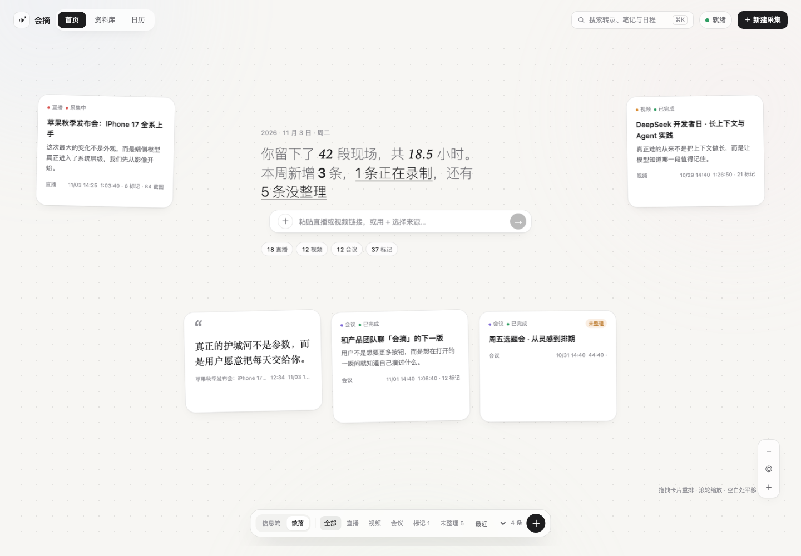
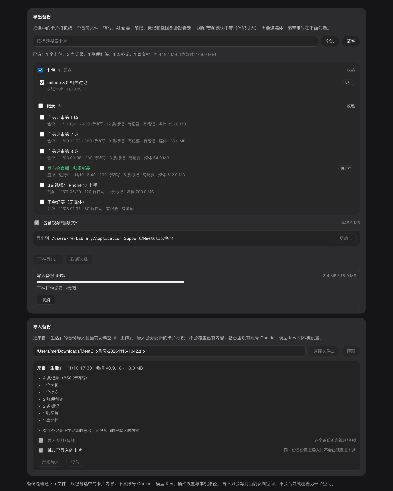

# 会摘 MeetClip · DeepSeek Harness 插件

[](LICENSE)
[](https://github.com/dengluliang/dsh-meetclip/releases)

把直播、视频和会议变成可检索、可回看的本地资料库：在 DeepSeek Harness（DSH）里采集 B 站直播、导入视频链接或本地录音，做云端转写、边看边打点、写 Markdown 笔记，并让 Agent 用 `meetclip_*` 工具检索、整理、生成 AI 纪要。0.9.0 起还可以在应用内检查并自动更新。



## 功能

- **三种采集**：B 站直播（边录边转写）、视频链接（B 站 / YouTube 等）、本地会议音视频。
- **批量会议导入**：会议录音页可一次选择或拖入多段音频/视频（含 mkv/flv），逐条转写；2 个及以上自动收进一个卡包，单文件仍按单条记录导入。
- **时间戳转写**：云端 ASR，转写行带时间码和发言人；默认按中文转写（设置 → 模型可改，单条可选「自动识别」），鼠标点任意时间戳即可跳转播放。
- **边看边记**：打点、截图、Markdown 笔记、待办；记录、笔记和截图都在本地资料库。
- **AI 纪要**：自动生成摘要、分节时间轴、结论、待办与术语表；支持增量更新与用户勾选/高亮反馈。
- **卡包**：批量会议导入会自动成包；在首页散落画布右键空白新建卡包，把一张卡拖到另一张卡上停留约 160ms 叠成卡包；外壳是卡包封面：包名 17.5px 当标题、一行类型构成、底部成员底片条（会话卡用真实封面，标记/便签/待办/文档/批次用类型色块，超过 4 张收成 +N），几张卡包并排也能一眼认出要打开哪个；展开后还原原卡片信息流，按住任意卡片即可拖动排序，卡片之间的空隙会显示横向插入线；成员可打开、移出或解散，卡包作为一张卡参与避让。
- **@ 卡片与基于卡片提问**：首页记录、卡包、便利签、标记、图片、批次和飞书文档都会生成 `会摘卡片/` 下的 Markdown，可在 Agent 的 @ 菜单直接选中；右键任意卡片/卡包（卡包浮层里的成员卡也支持）选「基于此卡片/卡包提问」，会新开 Agent 会话并把结构化引用放进输入框，不自动发送。
- **卡片重命名**：在首页记录卡上右键选「重命名」，标题就地变成输入框；保存后写回资料库里同一条记录，资料库列表、详情、搜索和 @ 卡片文件都跟着用新标题。
- **资料空间**：工作/生活多个资料库随时切换，账号与通用设置可共享。
- **备份与迁移**：设置 → 备份，按卡片选择导出 zip（记录 / 卡包 / 便利签 / 标记 / 图片 / 飞书文档 / 批次，可全选），也可以只挑一个卡包或几张卡；另一台电脑的会摘导入后，转写、AI 纪要、笔记、标记、截图和卡包都跟着走。视频/音频默认不带，勾选后一起带走；同一份备份重复导入默认不产生重复卡片。详见 [docs/BACKUP.md](docs/BACKUP.md)。
- **飞书文档卡片**：粘贴飞书文档链接，读成可在会话里 `@` 的卡片；可选登录飞书 MCP 读写文档、多维表格、云盘与 Wiki。
- **Agent 工具**：`meetclip_search`、`meetclip_records`、`meetclip_minutes`、`meetclip_marks`、`meetclip_notes`、`meetclip_calendar` 等。
- **应用内更新**：设置 → 关于 →「检查更新」只查版本，查到新版本后状态行改问「是否升级最新的 vX」、按钮变成「点击升级」，再点一次才下载 GitHub Release、校验 SHA-256、替换已安装副本，带进度条；更新内容按 Markdown 预览，升级后可一键回退到升级前的本地副本。




## 系统要求

- DeepSeek Harness 0.2.x（桌面版或网页版）
- macOS（当前主要验证平台；Windows/Linux 的路径已处理但未实测）
- Node.js 20+（仅开发/构建需要；运行时由 DSH 提供）
- 首次使用一键自举运行环境：自动下载 `uv` + 独立 CPython 3.12 与采集组件 `yt-dlp`/`ffmpeg`
  （国内镜像优先，**不需要**预装 Python、Homebrew，也**不需要**能连 GitHub），仅需网络
- 一个 OpenAI 兼容的模型服务：Base URL、模型 ID 和 API Key（云识别与 AI 纪要默认共用同一把 Key）。
  网关要求 `供应商/模型名` 时插件会按目录里的 `owned_by` 自动补全（0.9.5 起），语音与纪要同一套规则；部署方可用 meetclip config 的 `aiBaseUrl` 统一地址，用户只需粘贴 Key

## 安装

### 从 GitHub Releases（推荐）

1. 打开 [最新 Release](https://github.com/dengluliang/dsh-meetclip/releases/latest)，下载 `dsh-meetclip-<版本>.tgz` 到固定目录。
2. 打开 DSH：**设置 → 插件 → 添加插件**。
3. 填 tgz 的**绝对路径**，安装后启用「会摘」。
4. 首次打开按引导「一键安装并配置」，运行环境与采集组件自动下载（无需预装 Python / Homebrew），再填入 API Key。

> 只接受 `.tgz` 或含 `package.json` 的插件目录；不要填 zip、`dist/` 父目录或未构建的仓库根目录。

### 飞书 MCP：默认本地安装（0.9.21 起）

「设置 → 飞书 → 安装并连接」用 DSH 自带的 node 运行时与 pnpm 把飞书 MCP 装进 `~/.dsh/meetclip/feishu-mcp/`，**不需要预装 Node.js / npx**；要回到 npx 方式，在 meetclip config 里设 `feishuMode: npx`。

### 命令行

```bash
dsh plugin --profile desktop add "file:/absolute/path/to/dsh-meetclip-<版本>.tgz"
```

网页版把 `desktop` 换成 `web`，然后重启 DSH。更细的步骤、飞书配置和常见问题见 [INSTALL.md](INSTALL.md)。

## 更新

打开 **设置 → 会摘 → 关于**：

- 「当前运行版本 / 已安装版本 / 最新版本」分别显示内存中的版本、磁盘上已替换的版本和 GitHub 上的最新版本。
- 点「检查更新」：读取 Release 的 `latest.json`（失败时回退 GitHub API），只回报结果，不会自动下载；查到新版本后状态行变成「是否升级最新的 vX」，同一个按钮变成「点击升级」，再点才下载 → SHA-256 校验 → 安全解包 → 原子替换 DSH profile 里的插件副本。没有新版本时按钮仍是「检查更新」。下载过程显示百分比、已下载字节和速度，可取消。
- 完成后重启 DeepSeek Harness 生效；重启前会明确提示「已安装 vX，重启后生效」。
- 替换前会保留 `dsh-meetclip.update-bak-<旧版本>-<时间戳>` 备份；失败自动还原，进程中断后下次启动自动恢复。
- 升级后如果发现问题，同一个页面可以「回退到 vX」：把安装目录换回**升级前保存在本地的副本**（不联网、不从 GitHub 下载旧版本）。确认后提示重启；换下来的新版本也会另存为备份，还能再切回来。资料库、笔记和转写不受影响。没有升级备份（手工装包或源码运行）时按钮置灰并说明原因。
- 源码方式运行（`link:` / 开发目录）不会自动覆盖，只提示 `git pull`。
- 自动更新不改 profile 的 `package.json`/`pnpm-lock.yaml`；之后手动重装插件可能回到安装时的旧 tgz。新包留在 `~/.dsh/meetclip/updates/<版本>/`。

实现细节、feed 格式和发布流程见 [docs/UPDATE.md](docs/UPDATE.md)。

## 首次使用

1. 打开侧栏「会摘」→ 按引导「一键安装并配置」，插件自己下载 Python 运行环境与采集组件。
2. **首次引导第 1 步**：填入服务地址（Base URL）与 API Key（部署配了 `aiBaseUrl` 时地址会自动带出）。拉取清单后引导会各发一次最小请求，把能调通的语音与文字模型验证好再保存；之后想换到 **设置 → 会摘 → 模型**。
3. 首页「＋」选择发布会直播 / 视频链接 / 会议录音（支持多选音视频）/ 飞书文档；首页对话框仍用于问 Agent，贴链接也会交给 Agent。
4. 采集完成后在记录页看转写、打点、写笔记、生成 AI 纪要。
5. 账号统一在**会摘面板右上角「设置 → 账号」**：B 站扫码登录、抖音三步登录、飞书安装/登录/试读；模型、采集、存储与更新也都在同一设置弹层。
6. 首次引导装到一半刷新会接回进度；完成页可一键去试第一条，也可以随时在顶栏「？」打开使用指南。

飞书是可选项：**会摘面板右上角「设置 → 飞书」**（或首次引导第 3 步的「连接账号」）点「安装飞书 MCP」并登录后，Agent 才能读写飞书文档、多维表格与 Wiki。包名与 npm 源自带默认值；要换成自己的镜像，在 `cordis.patch.yml` 的 meetclip config 里填 `feishuPackage`、`feishuRegistry`（或环境变量 `MEETCLIP_FEISHU_PACKAGE`、`MEETCLIP_FEISHU_REGISTRY`）。

模型服务同理：插件不内置任何网关地址，但部署方可以在同一处 meetclip config 里写 `aiBaseUrl`，首次引导与设置页会直接带出该地址；没有配置时保持每次手填。

## 备份与迁移

在 **设置 → 会摘 → 备份** 里：

- **导出**：全选或挑选卡片（卡包可以整包带走；标记会连同所属记录一起导出）。默认不包含视频/音频，勾选后连同媒体一起打包；可选择导出目录，完成后在 Finder 中显示。备份是普通 zip，只含选中卡片的正文内容，不含账号 Cookie、模型 Key 或本机设置。
- **导入**：选择别人发来的备份，先读出清单与「已导入过多少」，确认后才写库。记录、便利签、图片、卡包都分配新标识，不会覆盖现有卡片；文档卡按链接去重；同一份备份重复导入默认跳过。
- 媒体可以在导出与导入时各选一次：没有媒体时记录照样有转写、纪要、笔记和标记，只是不能播放。
- 跨资料空间导入时只写当前激活的空间；备份任务在跑时切换资料空间会先要求确认并取消任务。

格式、去重与安全限额见 [docs/BACKUP.md](docs/BACKUP.md)。

## 数据与隐私

- 资料库默认位于 `~/.dsh/meetclip/data`（或设置里选定的目录），包含音视频、转写、截图、笔记和 SQLite 数据库。
- 云识别与 AI 纪要会把音频/文本发给你配置的 ASR / 模型服务；除此之外插件不向第三方上传资料。
- 「检查更新」只向 `github.com` 发 GET 请求，不上传资料库、笔记或转写；没有遥测。
- 备份文件只包含你选中的卡片内容，**不含**账号 Cookie、模型 Key、settings.json 与本机路径；导出后文件在你自己选择的目录里，由你决定发给谁。
- 更新包强制 HTTPS + SHA-256，解包拒绝绝对路径、`..`、符号链接和设备文件，不执行 shell。

## 开发

```bash
# 构建浏览器端 client.js（需要 esbuild/react）
npm install --prefix build
node build/build-client.mjs

# 前端与 Host 单元测试
node --test tests/*.test.mjs

# 打包插件（生成 meetclip-dsh-meetclip-<版本>.tgz）
npm pack --pack-destination dist

# 生成 Release 资产（tgz + latest.json + SHA256SUMS）
node build/release.mjs --dry-run
```

后端测试使用插件自己的 Python 环境：

```bash
MEETCLIP_TEST_PYTHON="$HOME/.dsh/meetclip/venv/bin/python" backend/tests/run-all.sh
```

目录结构：

```
index.js              Host 入口（路由、工具、skill 注册）
src/host/             Host：运行时、采集、飞书、更新器、安全解包
client-src/           React 客户端源码（Settings / 首页 / 详情页）
client.js             构建产物（npm pack 与 DSH 加载用）
backend/app/          FastAPI 后端（ASR、纪要、搜索、导出）
backend/tests/        后端测试
skills/jianbao/       内置「发布会简报」skill
tests/                Host / Client 单元测试
build/                构建、预览、截图与发布脚本
docs/                 架构、验证、更新说明
```

发布新版本：更新 `package.json` 版本与 `CHANGELOG.md`，运行 `node build/release.mjs --dry-run` 检查资产，再带 `GITHUB_TOKEN` 执行 `node build/release.mjs --upload`（或按脚本输出用 API 上传）。`latest.json` 是更新器读取的稳定入口。

## 兼容与限制

- 自动更新只替换已安装副本，不自动重装 Python 依赖；若新版本改了 `backend/requirements.txt`，需在设置里重装运行环境。
- 更新后必须重启 DSH 才能加载新的 Host/Client 代码（DSH 没有插件自重启 API）。
- 网络受限时更新器会给出「连不上 GitHub」提示；暂不自动读取 `HTTPS_PROXY`。
- 飞书 MCP 包名 / npm 源与模型服务地址都可以在 config 里换成你自己的镜像或网关。
- 主要验证平台是 macOS；Windows 的目录替换有回退逻辑但未实测。

## 许可证

[MIT](LICENSE)。第三方署名见 [THIRD_PARTY.md](THIRD_PARTY.md)（Cicada，Apache-2.0）。详见 [CHANGELOG.md](CHANGELOG.md)、[INSTALL.md](INSTALL.md) 和 [docs/](docs/)。
